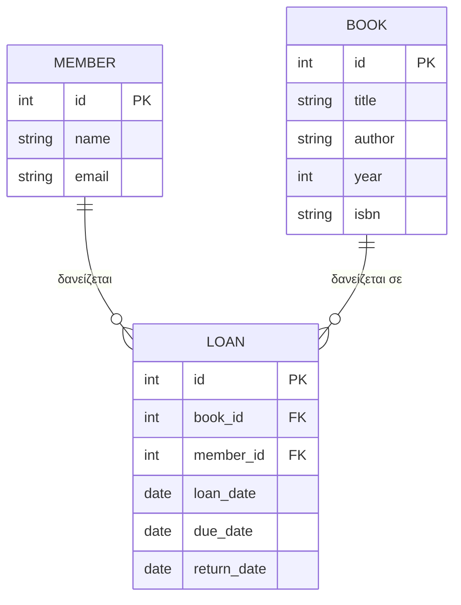
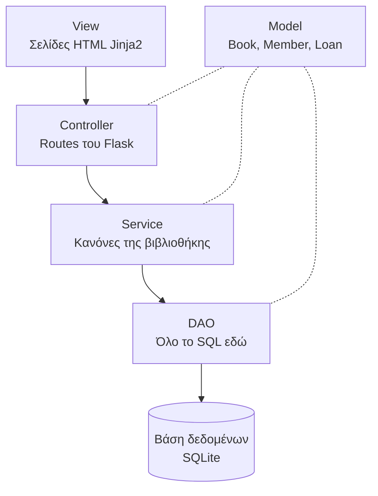

# Σχεδίαση εφαρμογής Library App

Εφαρμογή διαχείρισης δανεισμών μιας μικρής βιβλιοθήκης, γραμμένη σε Python με Flask, με αρχιτεκτονική MVC, μοτίβο DAO και αρχές SOLID.

## 1. Απαιτήσεις

Ο χρήστης της εφαρμογής είναι ο βιβλιοθηκάριος.

### Βιβλία
- Βλέπει τη λίστα με όλα τα βιβλία
- Προσθέτει, αλλάζει ή διαγράφει ένα βιβλίο

### Μέλη
- Βλέπει τη λίστα με τα μέλη
- Εγγράφει νέο μέλος

### Δανεισμοί
- Δανείζει ένα βιβλίο σε ένα μέλος
- Καταγράφει την επιστροφή ενός βιβλίου
- Βλέπει ποια βιβλία είναι δανεισμένα και ποια είναι εκπρόθεσμα

## 2. Οντότητες

| Οντότητα | Πεδία |
|---|---|
| `Book` (Βιβλίο) | id, title, author, year, isbn |
| `Member` (Μέλος) | id, name, email |
| `Loan` (Δανεισμός) | id, book_id, member_id, loan_date, due_date, return_date |

### Σχέσεις
- Ένα μέλος μπορεί να έχει πολλούς δανεισμούς.
- Ένα βιβλίο μπορεί να έχει δανειστεί πολλές φορές στο πέρασμα του χρόνου, αλλά μόνο μία φορά ταυτόχρονα.
- Το `return_date` μένει κενό όσο το βιβλίο δεν έχει επιστραφεί. Έτσι ξέρουμε αν ένα βιβλίο είναι διαθέσιμο.



## 3. Κανόνες της βιβλιοθήκης

1. Δεν δανείζεται βιβλίο που είναι ήδη δανεισμένο.
2. Ένα μέλος μπορεί να έχει μέχρι 3 ενεργούς δανεισμούς.
3. Η διάρκεια δανεισμού είναι 14 ημέρες.
4. Ένας δανεισμός είναι εκπρόθεσμος αν πέρασε η προθεσμία και δεν έχει επιστραφεί.
5. Δεν διαγράφεται βιβλίο που είναι δανεισμένο.

## 4. Αρχιτεκτονική

Ο κώδικας χωρίζεται σε στρώματα. Κάθε στρώμα μιλάει μόνο με το στρώμα ακριβώς από κάτω του.



| Στρώμα | Ευθύνη | Φάκελος |
|---|---|---|
| Model | Απλές κλάσεις με τα δεδομένα | `models/` |
| DAO | Αποθήκευση και ανάγνωση από τη βάση | `dao/` |
| Service | Έλεγχος των κανόνων της βιβλιοθήκης | `services/` |
| Controller | Παραλαβή αιτημάτων και επιλογή σελίδας | `controllers/` |
| View | Εμφάνιση σελίδων στον χρήστη | `templates/` |

### Παράδειγμα ροής, δανεισμός βιβλίου
1. Ο χρήστης πατάει «Δάνεισε» στη σελίδα (View).
2. Ο Controller παίρνει το αίτημα και καλεί το LoanService.
3. Το Service ελέγχει τους κανόνες, αν το βιβλίο είναι διαθέσιμο και αν το μέλος έχει λιγότερους από 3 δανεισμούς.
4. Αν όλα είναι σωστά, ζητάει από το LoanDAO να αποθηκεύσει τον νέο δανεισμό.
5. Το DAO γράφει τα δεδομένα στη βάση με SQL.
6. Ο Controller εμφανίζει νέα σελίδα με μήνυμα επιτυχίας ή λάθους.

## 5. Αρχές SOLID στο project

- **S, Single Responsibility.** Κάθε στρώμα και κάθε κλάση έχει μία δουλειά.
- **O, Open/Closed.** Νέοι κανόνες προστίθενται χωρίς αλλαγή στον υπάρχοντα κώδικα.
- **L, Liskov Substitution.** Ένα ψεύτικο DAO για τα tests αντικαθιστά το πραγματικό χωρίς να σπάσει τίποτα.
- **I, Interface Segregation.** Μικρά και στοχευμένα interfaces.
- **D, Dependency Inversion.** Το Service δέχεται το DAO απ' έξω και δεν το δημιουργεί μόνο του.

## 6. Δομή φακέλων

```
library-app/
├── app.py
├── models/
├── dao/
├── services/
├── controllers/
├── templates/
└── tests/
```

## 7. Τεχνολογίες

- Python 3.12
- Flask
- SQLite (μέσω της βιβλιοθήκης sqlite3)
- Git και GitHub
- VS Code