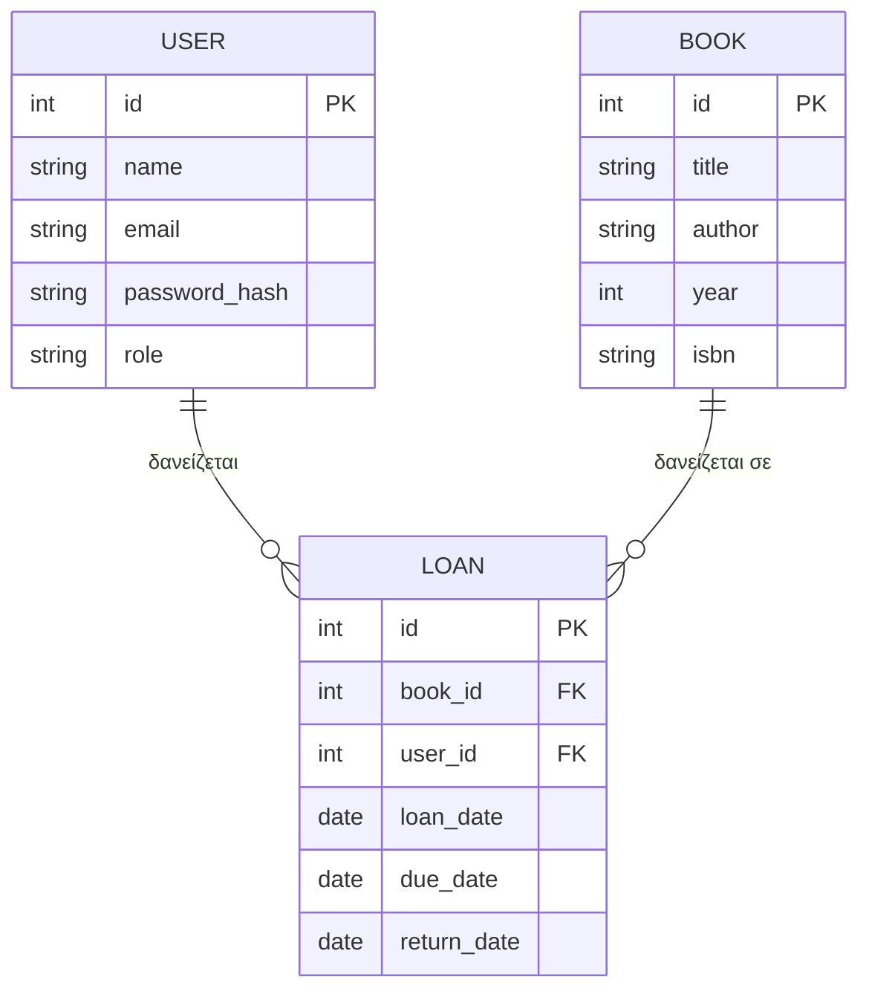
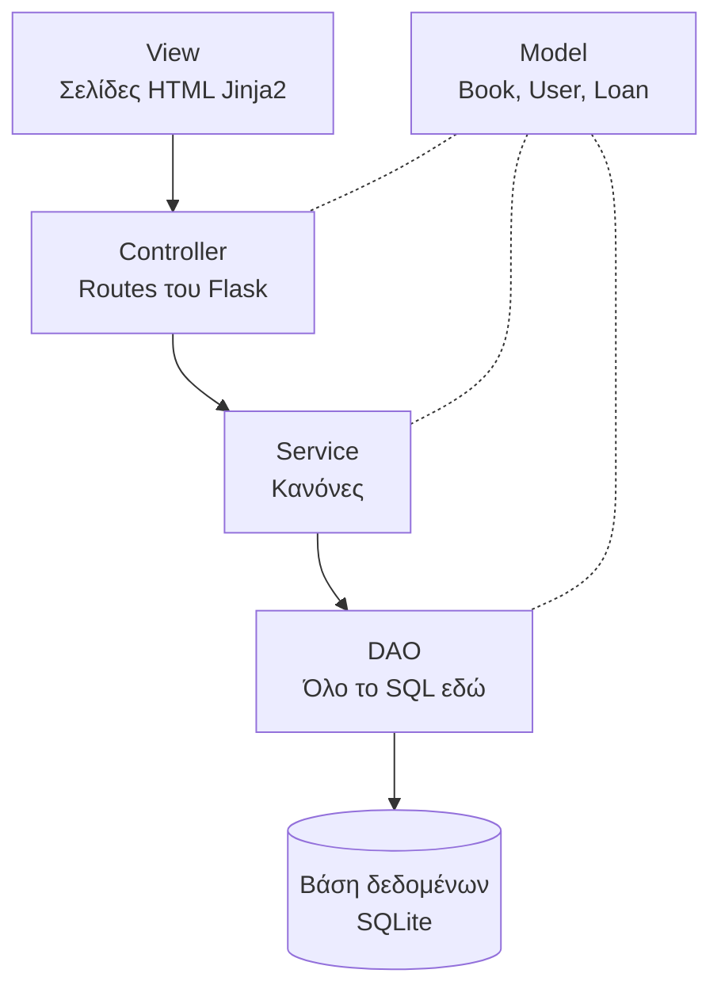

# Σχεδίαση εφαρμογής Library App

Εφαρμογή δανεισμού βιβλίων μιας μικρής βιβλιοθήκης, γραμμένη σε Python με Flask, με αρχιτεκτονική MVC, μοτίβο DAO και αρχές SOLID.

## 1. Ρόλοι και απαιτήσεις

### Επισκέπτης (χωρίς σύνδεση)
- Βλέπει την αρχική σελίδα
- Κάνει εγγραφή με όνομα, email και κωδικό
- Συνδέεται με email και κωδικό

### Χρήστης (μετά τη σύνδεση)
- Βλέπει τα διαθέσιμα βιβλία, δηλαδή όσα δεν είναι δανεισμένα
- Δανείζεται ένα διαθέσιμο βιβλίο
- Βλέπει τα βιβλία που έχει τώρα και την προθεσμία επιστροφής τους
- Επιστρέφει ένα βιβλίο
- Βλέπει το ιστορικό όλων των δανεισμών του
- Αποσυνδέεται

### Admin (διαχειριστής)
- Διαχείριση βιβλίων, προβολή, προσθήκη, αλλαγή, διαγραφή (CRUD)
- Διαχείριση χρηστών, προβολή, προσθήκη, αλλαγή στοιχείων και ρόλου, ορισμός νέου κωδικού, διαγραφή (CRUD)
- Αποσυνδέεται

## 2. Οντότητες

| Οντότητα | Πεδία |
|---|---|
| `Book` (Βιβλίο) | id, title, author, year, isbn |
| `User` (Χρήστης) | id, name, email, password_hash, role |
| `Loan` (Δανεισμός) | id, book_id, user_id, loan_date, due_date, return_date |

- Το `role` παίρνει μόνο τις τιμές `admin` ή `user`.
- Ο κωδικός δεν αποθηκεύεται ποτέ όπως είναι. Αποθηκεύεται μόνο το hash του.
- Το `return_date` μένει κενό όσο το βιβλίο δεν έχει επιστραφεί.
- Η διαθεσιμότητα ενός βιβλίου δεν αποθηκεύεται. Υπολογίζεται από τους δανεισμούς χωρίς `return_date`.

### Σχέσεις
- Ένας χρήστης μπορεί να έχει πολλούς δανεισμούς.
- Ένα βιβλίο μπορεί να έχει δανειστεί πολλές φορές στο πέρασμα του χρόνου, αλλά μόνο μία φορά ταυτόχρονα.



## 3. Κανόνες

### Εγγραφή και σύνδεση
1. Όνομα, email και κωδικός είναι υποχρεωτικά.
2. Το email πρέπει να είναι μοναδικό.
3. Ο κωδικός πρέπει να έχει τουλάχιστον 6 χαρακτήρες.
4. Κάθε νέος χρήστης από την εγγραφή έχει ρόλο `user`.
5. Ο πρώτος admin δημιουργείται με το script `create_admin.py`.

### Δανεισμοί
1. Δεν δανείζεται βιβλίο που είναι ήδη δανεισμένο.
2. Ένας χρήστης μπορεί να έχει μέχρι 3 ενεργούς δανεισμούς.
3. Η διάρκεια δανεισμού είναι 14 ημέρες.
4. Ένας δανεισμός είναι εκπρόθεσμος αν πέρασε η προθεσμία και δεν έχει επιστραφεί.
5. Ο χρήστης μπορεί να επιστρέψει μόνο δικό του δανεισμό, και μόνο αν δεν έχει ήδη επιστραφεί.

### Διαχείριση
1. Δεν διαγράφεται βιβλίο που έχει δανεισμούς.
2. Δεν διαγράφεται χρήστης που έχει δανεισμούς.
3. Ο admin δεν μπορεί να διαγράψει τον εαυτό του.

### Πρόσβαση
1. Οι σελίδες του χρήστη απαιτούν σύνδεση. Χωρίς σύνδεση γίνεται μεταφορά στη σελίδα σύνδεσης.
2. Οι σελίδες `/admin/...` επιτρέπονται μόνο σε χρήστη με ρόλο `admin`.

## 4. Σελίδες και διευθύνσεις

| Ποιος | Διεύθυνση | Τι κάνει |
|---|---|---|
| Όλοι | `/` | Αρχική σελίδα |
| Όλοι | `/register` | Εγγραφή |
| Όλοι | `/login` | Σύνδεση |
| Συνδεδεμένοι | `/logout` | Αποσύνδεση |
| Χρήστης | `/books` | Διαθέσιμα βιβλία |
| Χρήστης | `/books/<id>/borrow` | Δανεισμός βιβλίου |
| Χρήστης | `/my/loans` | Τα βιβλία μου, με προθεσμίες |
| Χρήστης | `/my/loans/<id>/return` | Επιστροφή βιβλίου |
| Χρήστης | `/my/history` | Ιστορικό δανεισμών |
| Admin | `/admin/books` | Λίστα βιβλίων |
| Admin | `/admin/books/new` | Νέο βιβλίο |
| Admin | `/admin/books/<id>/edit` | Αλλαγή βιβλίου |
| Admin | `/admin/books/<id>/delete` | Διαγραφή βιβλίου |
| Admin | `/admin/users` | Λίστα χρηστών |
| Admin | `/admin/users/new` | Νέος χρήστης |
| Admin | `/admin/users/<id>/edit` | Αλλαγή χρήστη |
| Admin | `/admin/users/<id>/delete` | Διαγραφή χρήστη |

Μετά τη σύνδεση, ο χρήστης μεταφέρεται στο `/books` και ο admin στο `/admin/books`.

## 5. Αρχιτεκτονική

Ο κώδικας χωρίζεται σε στρώματα. Κάθε στρώμα μιλάει μόνο με το στρώμα ακριβώς από κάτω του.



| Στρώμα | Ευθύνη | Φάκελος |
|---|---|---|
| Model | Απλές κλάσεις με τα δεδομένα | `models/` |
| DAO | Αποθήκευση και ανάγνωση από τη βάση | `dao/` |
| Service | Έλεγχος κανόνων, κρυπτογράφηση κωδικών | `services/` |
| Controller | Παραλαβή αιτημάτων, έλεγχος πρόσβασης, επιλογή σελίδας | `controllers/` |
| View | Εμφάνιση σελίδων | `templates/` |

### Παράδειγμα ροής, δανεισμός βιβλίου
1. Ο χρήστης πατάει «Δανεισμός» στη σελίδα διαθέσιμων βιβλίων (View).
2. Ο Controller ελέγχει ότι ο χρήστης είναι συνδεδεμένος και καλεί το LoanService.
3. Το LoanService ελέγχει ότι το βιβλίο είναι διαθέσιμο και ότι ο χρήστης έχει λιγότερους από 3 δανεισμούς.
4. Αν όλα είναι σωστά, υπολογίζει την προθεσμία (σήμερα και 14 ημέρες) και ζητάει από το LoanDAO να αποθηκεύσει τον δανεισμό.
5. Το LoanDAO γράφει στη βάση με SQL.
6. Ο Controller εμφανίζει μήνυμα επιτυχίας ή λάθους και ξαναδείχνει τη λίστα.

### Παράδειγμα ροής, σύνδεση
1. Ο επισκέπτης συμπληρώνει email και κωδικό (View).
2. Ο Controller καλεί το UserService.
3. Το UserService βρίσκει τον χρήστη από το email μέσω του UserDAO και ελέγχει τον κωδικό με το hash.
4. Αν είναι σωστά, ο Controller αποθηκεύει το id του χρήστη στο session και τον μεταφέρει στη σωστή περιοχή.

## 6. Αρχές SOLID στο project

- **S, Single Responsibility.** Κάθε στρώμα και κάθε κλάση έχει μία δουλειά. Το DAO δεν ελέγχει κανόνες, το Service δεν γράφει SQL, ο Controller δεν αποφασίζει κανόνες.
- **O, Open/Closed.** Νέοι κανόνες προστίθενται χωρίς αλλαγή στον υπάρχοντα κώδικα.
- **L, Liskov Substitution.** Ένα ψεύτικο DAO για τα tests αντικαθιστά το πραγματικό χωρίς να σπάσει τίποτα.
- **I, Interface Segregation.** Μικρά και στοχευμένα interfaces.
- **D, Dependency Inversion.** Τα Services δέχονται τα DAO απ' έξω και δεν τα δημιουργούν μόνα τους.

## 7. Δομή φακέλων

```
library-app/
├── app.py                    εκκίνηση εφαρμογής
├── database.py               σύνδεση με τη βάση
├── schema.sql                πίνακες της βάσης
├── create_admin.py           δημιουργία του πρώτου admin
├── models/
│   ├── book.py
│   ├── user.py
│   └── loan.py
├── dao/
│   ├── book_dao.py
│   ├── user_dao.py
│   └── loan_dao.py
├── services/
│   ├── book_service.py
│   ├── user_service.py
│   └── loan_service.py
├── controllers/
│   ├── auth_controller.py    εγγραφή, σύνδεση, αποσύνδεση
│   ├── user_controller.py    διαθέσιμα βιβλία, δανεισμός, επιστροφή, ιστορικό
│   └── admin_controller.py   CRUD βιβλίων και χρηστών
├── templates/
│   ├── base.html
│   ├── home.html
│   ├── auth/
│   ├── user/
│   └── admin/
└── static/
    └── style.css
```

## 8. Σειρά υλοποίησης

1. Models και σχήμα βάσης
2. DAO για βιβλία, χρήστες και δανεισμούς
3. Services με τους κανόνες
4. Εγγραφή, σύνδεση, αποσύνδεση
5. Περιοχή χρήστη, διαθέσιμα βιβλία, δανεισμός, επιστροφή, ιστορικό
6. Περιοχή admin, CRUD βιβλίων
7. Περιοχή admin, CRUD χρηστών
8. Εμφάνιση και στυλ

## 9. Τεχνολογίες

- Python 3.12
- Flask (με Werkzeug για την κρυπτογράφηση κωδικών και Jinja2 για τις σελίδες)
- SQLite μέσω της βιβλιοθήκης sqlite3
- Git και GitHub
- VS Code
